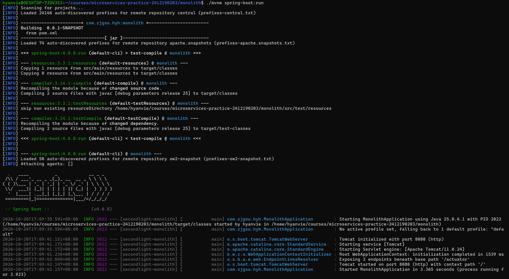
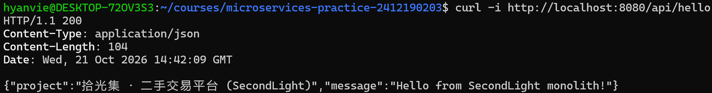
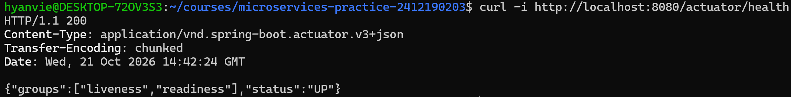
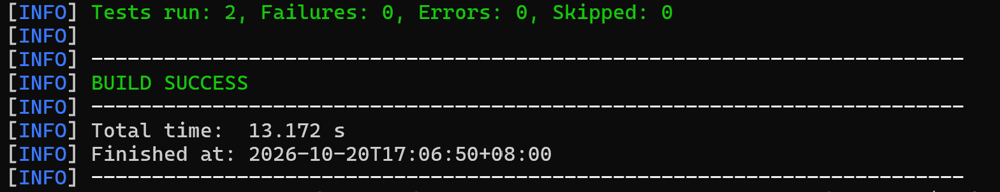

# Week 03：项目提案与 Spring Boot 起步

## 本周目标

这周主要做两件事：一是把第 2 周确定的项目再往前推一步，写一份简短的项目提案，想清楚先做哪个业务场景、有哪两个核心模型；二是在仓库里搭一个能跑起来的 Spring Boot 工程，为后面写业务代码打基础。这周不涉及业务建模和数据库，只要求工程能启动、能验证运行状态。

## 项目提案

提案已经写好，放在 [`docs/project-proposal.md`](../../project-proposal.md)，主要内容是：

- **优先实现的业务场景**：买家下单购买一件在售商品。这是交易里最核心的一环，后面的库存锁定、服务拆分、事务一致性都会从这里展开。
- **两个核心模型**：商品（Item）和订单（Order）。用户先不单独建模型，用 `buyerId`、`sellerId` 记录，等做认证时再补。

## 本周计划

- [x] 写好项目提案 `docs/project-proposal.md`
- [x] 确认本机 JDK 版本是 25（之前环境里是 17，需要换）
- [x] 用 Spring Initializr 生成工程，放到仓库根目录的 `monolith/` 下（Maven、Java 25、Spring Boot 4.0.x，Group 和 Package 都用 `com.zjgsu.hyh`）
- [x] 把配置改成 `application.yml`，端口用默认的 8080
- [x] 写一个 GET 接口，用来确认应用在正常运行
- [x] 接入 Actuator，确认 `/actuator/health` 可以访问
- [x] 写一个启动测试，让 `./mvnw test` 能重复通过
- [x] 运行验证：执行 `./mvnw spring-boot:run`，访问两个接口，把命令和结果截图保存到仓库
- [ ] 更新根目录 `README.md`，补上工程所在目录、运行方式和测试方式

## 创建并运行 Spring Boot 工程

### 工程说明

在仓库根目录新建了 `monolith/`，用 Spring Initializr 生成 Maven 工程，包含 Spring Web MVC 和 Actuator。

- Java 25，Spring Boot 4.0.8，Maven（使用 Maven Wrapper，不需要单独安装 Maven）
- Group / Package：`com.zjgsu.hyh`
- 配置文件：`monolith/src/main/resources/application.yml`
- 应用名：`secondlight-monolith`，端口使用默认的 8080（没有修改）
- 新增接口：`GET /api/hello`，返回项目名称和问候语，用来确认应用在正常运行

### 启动命令

在 `monolith/` 目录下执行：

```bash
./mvnw spring-boot:run   # 启动应用，监听 8080 端口
```

日志里可以看到 Spring Boot 4.0.8、Java 25，Tomcat 在 8080 端口启动，Actuator 暴露了 2 个端点，最后出现 `Started MonolithApplication`，说明启动成功：



### 接口验证

**1. GET /api/hello**

```bash
curl -i http://localhost:8080/api/hello
```

响应状态码 200，内容如下：

```json
{"project":"拾光集 · 二手交易平台 (SecondLight)","message":"Hello from SecondLight monolith!"}
```



**2. GET /actuator/health**

```bash
curl -i http://localhost:8080/actuator/health
```

响应状态码 200，`status` 为 `UP`：

```json
{"groups":["liveness","readiness"],"status":"UP"}
```



## 启动测试

项目里一共有 2 个测试：

- `MonolithApplicationTests`：Initializr 自带的 `@SpringBootTest` 测试（`contextLoads`），检查 Spring 应用上下文能正常加载，也就是作业要求的启动测试
- `HelloControllerTests`：我额外补充的接口测试，检查 `/api/hello` 返回 200，并且 JSON 里有 `project` 和 `message` 字段

在 `monolith/` 目录下执行：

```bash
./mvnw test
```

结果是 `BUILD SUCCESS`，2 个测试全部通过：



## 下周衔接

这周的工程只是个空架子。下周准备在这个工程上开始建商品和订单两个模型，并写基础的 REST 接口，字段以提案里的设计为起点，建模时再按实际情况调整。
