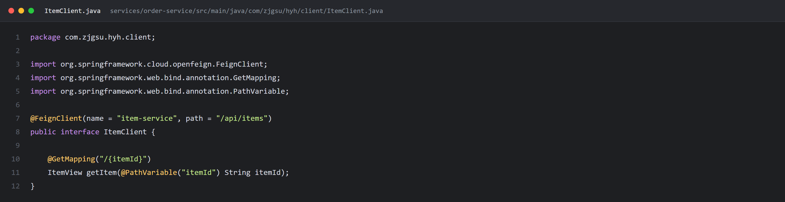
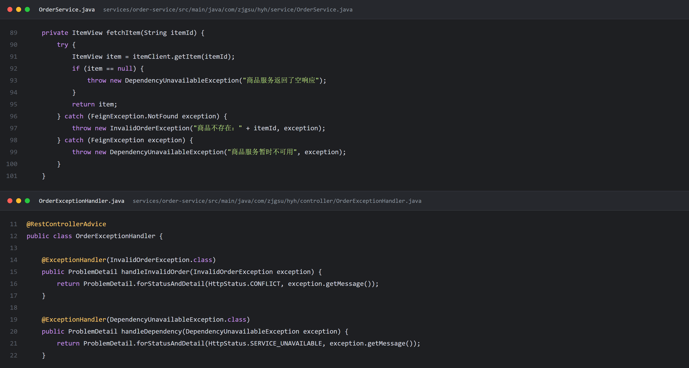
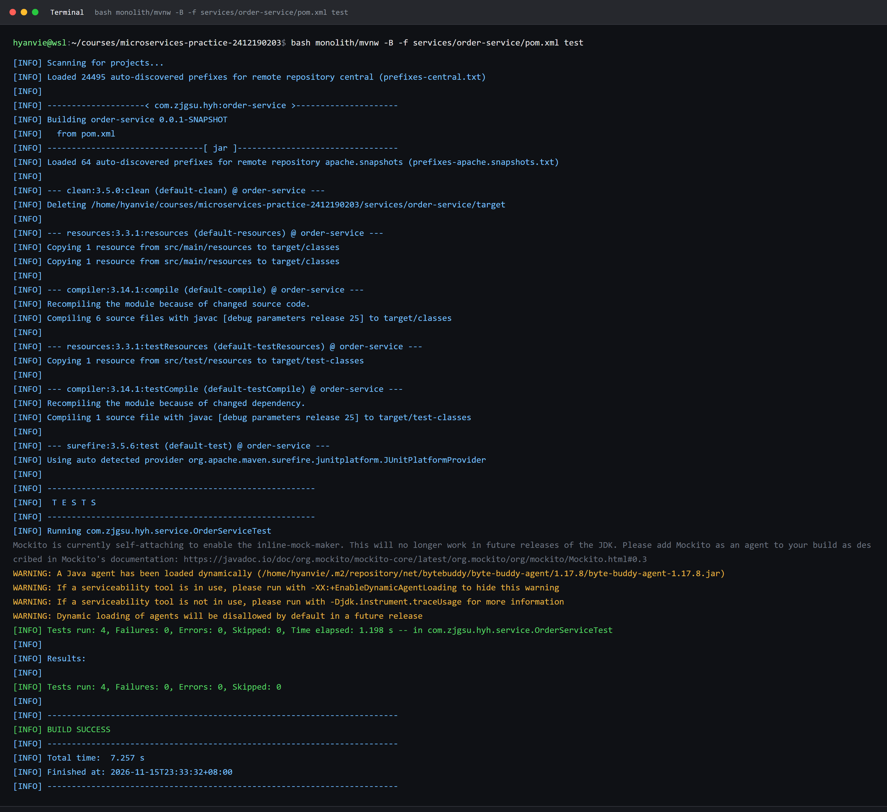
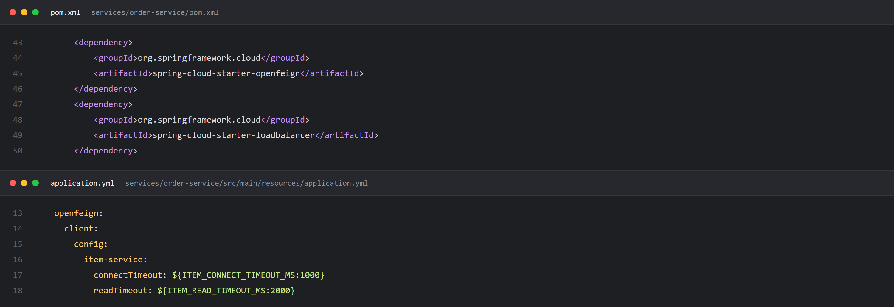
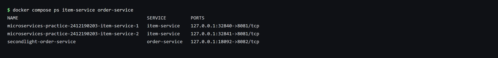
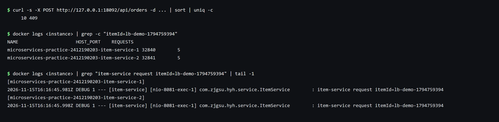
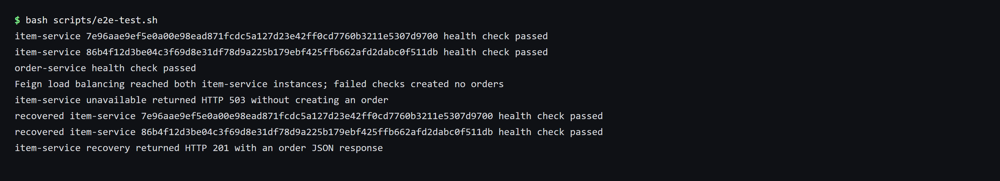
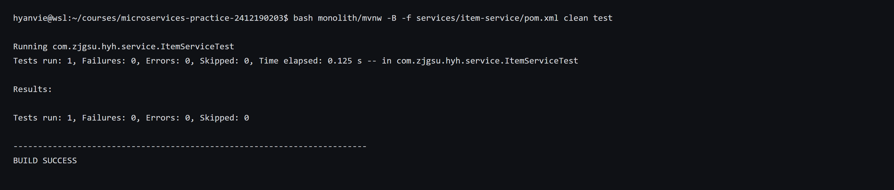
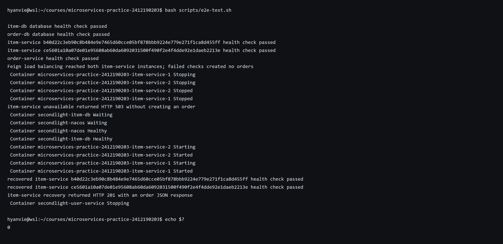

# 第八周：服务通信与负载均衡

## 选择一个跨服务业务流程

本周实现二手交易平台的“创建订单前校验商品”流程。调用方是 `order-service`，被调用方是 `item-service`。客户端请求 `POST /api/orders` 后，订单服务通过 OpenFeign 调用商品服务的 `GET /api/items/{itemId}`，确认商品存在且在售，再把商品 ID、买家 ID、卖家 ID 和当时的价格写入订单服务自己的数据库。订单服务不直接访问商品数据库，也不调用课堂中的选课服务或复用选课业务规则。

`item-service` 通过 Nacos 以 `item-service` 服务名注册；Feign 使用服务名而非固定 IP，Spring Cloud LoadBalancer 从健康实例中选择目标。错误商品映射为 HTTP `409`，商品服务不可用映射为 HTTP `503`；只有商品校验通过才写入订单。该流程是先查询再创建的同步协作，不构成跨服务事务，也不包含商品锁定或库存预留。

调用链路图和一致性边界见 [服务间同步调用与负载均衡](../../service-communication.md)。

工作区现有进度 PPT 第 5 页展示的服务通信结果是依赖服务下线返回 `503`、恢复后创建订单返回 `201`。本作业沿用这两个状态码验证服务故障恢复；商品不存在或不可购买时的 `409` 是另一种业务错误，不替代依赖不可用的 `503`。

## 实现思路

1. 在 `order-service` 声明 OpenFeign `ItemClient`，以 `item-service` 为服务名访问 `GET /api/items/{itemId}`。
2. 通过 Nacos 服务发现和 Spring Cloud LoadBalancer 在多个商品服务实例间分配请求；连接和读取超时沿用 `ITEM_CONNECT_TIMEOUT_MS`、`ITEM_READ_TIMEOUT_MS`。
3. 把 Feign 的 `404` 映射为商品业务冲突，把其他 Feign 远程调用异常映射为依赖不可用；失败请求不写入订单。
4. 在根 `compose.yaml` 中允许扩展商品服务副本，并让 `scripts/e2e-test.sh` 使用两个实例验证真实请求分配。

## 运行命令

单元测试（从仓库根目录运行）：

```bash
bash monolith/mvnw -B -f services/order-service/pom.xml test
```

端到端测试（需 Docker Compose、已配置的本地 `.env` 和可用的 Nacos 凭据）：

```bash
bash scripts/e2e-test.sh
```

脚本会构建并启动服务，验证商品服务两个实例健康、成功创建订单的 JSON 响应、错误商品的 `409` 与订单数据不变，并检查两个实例都实际收到 Feign 请求；随后停止两个商品服务实例，验证不可用时返回 `503` 且未落订单，恢复服务后再验证 `201`。脚本停止并移除本次启动的容器和网络，但保留命名数据卷。

## 运行结果与截图

- 订单服务单元测试：`bash monolith/mvnw -B -f services/order-service/pom.xml test`，4 项测试通过。
- 商品服务回归测试：`bash monolith/mvnw -B -f services/item-service/pom.xml test`，1 项测试通过。
- Compose 端到端（Docker Compose、Nacos、MySQL 与商品服务双实例）：`bash scripts/e2e-test.sh` 实际运行通过，验证了双实例请求分配、依赖下线返回 `503` 以及恢复后创建订单返回 `201`。脚本退出时移除本次启动的容器和网络，命名数据卷保留。

## 使用 OpenFeign

### 实现思路

调用方为 `order-service`，被调用方为 `item-service`。订单服务中的 `ItemClient` 使用 `@FeignClient(name = "item-service", path = "/api/items")` 按 Nacos 服务名声明调用契约，通过 `GET /{itemId}` 查询商品；Spring Cloud LoadBalancer 根据服务发现结果选择实例，不在客户端写死容器 IP。OpenFeign 连接和读取超时分别由 `ITEM_CONNECT_TIMEOUT_MS`、`ITEM_READ_TIMEOUT_MS` 配置。

订单服务仅在商品查询成功且商品在售时保存订单。商品服务返回 `404` 时转换为清晰的 `409` 商品业务错误；其他 Feign 调用异常（例如服务无可用实例时的 `503`）转换为“商品服务暂时不可用”，并返回 HTTP `503`。两种失败路径都在订单写入前结束。实现与调用失败映射见 [OrderService](../../../services/order-service/src/main/java/com/zjgsu/hyh/service/OrderService.java)；Feign 契约见 [ItemClient](../../../services/order-service/src/main/java/com/zjgsu/hyh/client/ItemClient.java)。

### 运行命令与结果

从仓库根目录执行订单服务测试：

```bash
bash monolith/mvnw -B -f services/order-service/pom.xml clean test
```

结果：`BUILD SUCCESS`，`Tests run: 4, Failures: 0, Errors: 0, Skipped: 0`。4 项用例分别覆盖成功读取商品并创建订单、商品不存在映射为 `409`、Feign 依赖故障映射为 `503`，以及商品不可购买时不写订单。

需要 Docker、Nacos 和本地 `.env` 才能运行完整服务发现及双实例验证：

```bash
bash scripts/e2e-test.sh
```

端到端脚本已在 Docker 环境实际运行通过，结果见下文“负载均衡验证”。

### 截图



`ItemClient` 使用 `@FeignClient(name = "item-service", path = "/api/items")`，未出现任何容器 IP。



`OrderService#fetchItem` 将远程 `404` 转为 `409` 业务冲突，其余 Feign 异常转为 `503` 依赖不可用；`OrderExceptionHandler` 负责输出对应状态码。



`surefire` 执行 4 项测试全部通过，`BUILD SUCCESS`。



`spring-cloud-starter-openfeign`、`spring-cloud-starter-loadbalancer` 依赖，以及 `item-service` 的连接与读取超时配置。

## 负载均衡验证

### 实现思路

`item-service` 不设置固定 `container_name`，宿主机端口由 `ITEM_SERVICE_PORT` 控制；端到端脚本把该变量设为 `0`，Docker 为每个副本分配不同端口，避免两个实例争用同一宿主机端口。`order-service` 通过 `item-service` 服务名和 Spring Cloud LoadBalancer 选择实例，不感知具体容器地址。

每个副本在 `ItemService#getItem` 打印 `item-service request itemId=...`，日志级别由 `ITEM_SERVICE_LOG_LEVEL` 控制（默认 `INFO`，验证时设为 `DEBUG`）。分发是否真实发生以两个副本各自的请求日志为准，而不是只看 Nacos 注册列表。

### 运行命令

启动两个商品服务副本：

```bash
ITEM_SERVICE_PORT=0 ITEM_SERVICE_LOG_LEVEL=DEBUG \
  docker compose up -d --build --scale item-service=2
```

查看实例与宿主机端口，并向订单服务连续下单后统计各副本日志：

```bash
docker compose ps item-service order-service
for c in $(docker compose ps -q item-service); do
  docker logs "$c" 2>&1 | grep -c "item-service request itemId=lb-demo-"
done
```

一键验证（包含双实例分发、`503` 下线、`201` 恢复）：

```bash
bash scripts/e2e-test.sh
```

### 运行结果

两个副本分别映射到 `127.0.0.1:32840` 和 `127.0.0.1:32841`，同一镜像、不同宿主机端口。连续 10 次 `POST /api/orders`（不存在的商品，均返回 `409`）后，两个副本的日志各命中 5 次，说明请求由负载均衡实际分配到两个实例。`scripts/e2e-test.sh` 输出 `Feign load balancing reached both item-service instances`，随后停止实例返回 `503`、恢复后返回 `201`。

### 截图



`docker compose ps` 显示两个 `item-service` 副本分别占用 `32840`、`32841`，订单服务占用 `18092`。



10 次调用后两个副本各收到 5 次请求，并附两个实例各自的请求日志行。



`scripts/e2e-test.sh` 实际输出：双实例均通过健康检查、Feign 请求到达两个实例、依赖不可用返回 `503`、恢复后创建订单返回 `201`。

## 测试

### 实现思路

测试分三层：单元测试覆盖 Feign 调用路径的正常与异常分支，确保不把依赖失败当成业务成功；端到端脚本覆盖跨服务完整流程，验证真实双实例分发、`503` 下线和 `201` 恢复；最后说明写操作超时后的结果未知性。

单元测试位于订单服务 `OrderServiceTest` 和商品服务 `ItemServiceTest`。订单服务 4 项用例：
- 成功读取商品（在售）并创建订单；
- 商品不存在（Feign `404`）映射为 `409` 业务冲突且不落订单；
- 商品服务整体不可用（Feign 异常）映射为 `503` 依赖不可用且不落订单；
- 商品存在但不可购买时不创建订单。

端到端脚本 `scripts/e2e-test.sh` 在 Docker 中起两实例商品服务，验证真实 Feign 调用落到两个副本；随后停止两个实例，连续下单应全部返回 `503` 且数据库无新增订单；恢复实例后再下单应返回 `201` 和完整订单 JSON。

### 运行命令与结果

单元测试（本轮实际运行）：

```bash
bash monolith/mvnw -B -f services/order-service/pom.xml clean test
bash monolith/mvnw -B -f services/item-service/pom.xml clean test
```

结果：订单服务 `Tests run: 4, Failures: 0`；商品服务 `Tests run: 1, Failures: 0`。

端到端脚本（本轮已在 Docker 可用的 WSL 环境中实际运行通过）：

```bash
bash scripts/e2e-test.sh
```

本次运行输出：
1. 两个商品服务实例健康检查通过（容器 ID `b40d22...`、`ce5601...`）；
2. `Feign load balancing reached both item-service instances`，同一批 Feign 请求真实到达两个实例；
3. 停止两个实例后返回 `HTTP 503`，且订单数据库无新增记录；
4. 恢复实例后重新健康，返回 `HTTP 201` 和订单 JSON。

脚本退出码为 `0`，清理了本次启动的所有容器和 compose 网络（保留 MySQL 命名数据卷）。

### 写操作超时的结果未知性

订单创建调用了远程 `item-service` 校验，这是一次**写操作前置读**。当远程调用超时或网络抖动时，调用方无法确认商品服务是否实际执行了校验，也就无法安全地把订单写入自己的数据库。本实现选择**乐观不成立则悲观拒绝**——直接返回 `503` 并由前端/调用方决定是否重试，而不是在本地先落单再等待后续补偿或回滚。这样做的好处是避免了"本地订单已创建但远程商品校验结果未知"的不一致状态；代价是调用方可能得到重试中的失败，需要做好幂等请求。

如果未来业务必须保证"只要远程最终允许，本地必须写入订单"，需要额外引入：幂等键（让重复下单请求可以安全重试）、订单写入的预提交状态、以及与商品服务之间的最终一致性补偿。当前作业范围不实现这些，只在测试中证明"依赖不可用时不会把调用失败当成业务成功"。

### 截图


`clean test` 执行 4 项测试全部通过，覆盖正常下单、`404→409` 业务冲突、Feign 异常→`503` 依赖不可用、商品不可购买时不写订单。



`ItemServiceTest` 回归通过，保证被调用方的核心业务逻辑未被修改破坏。



`scripts/e2e-test.sh` 完整输出：双实例健康、Feign 请求到达两副本、依赖下线返回 `503`、恢复后创建订单返回 `201`，退出码 `0`。
