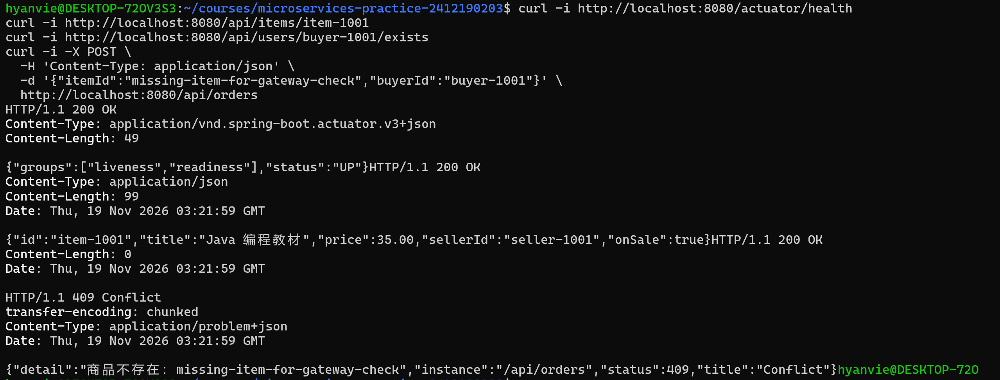
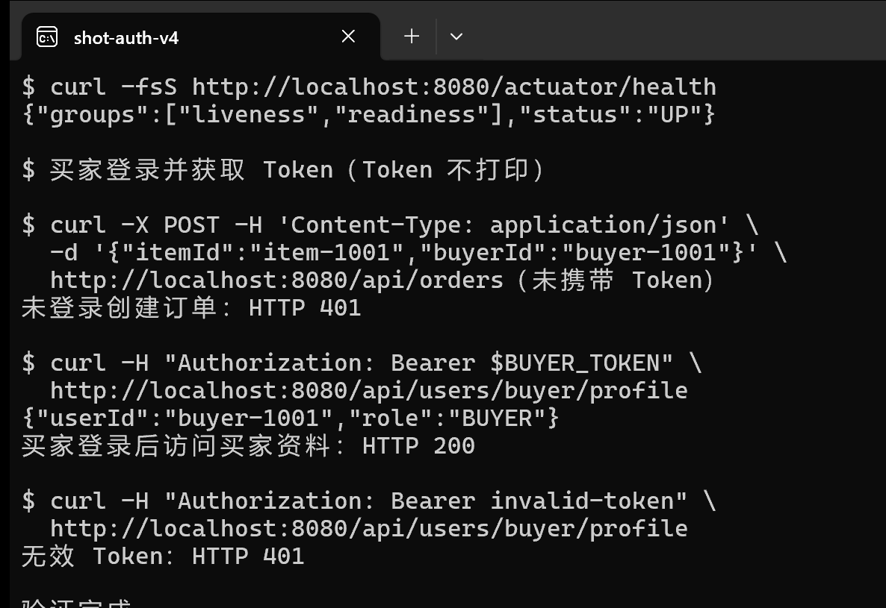
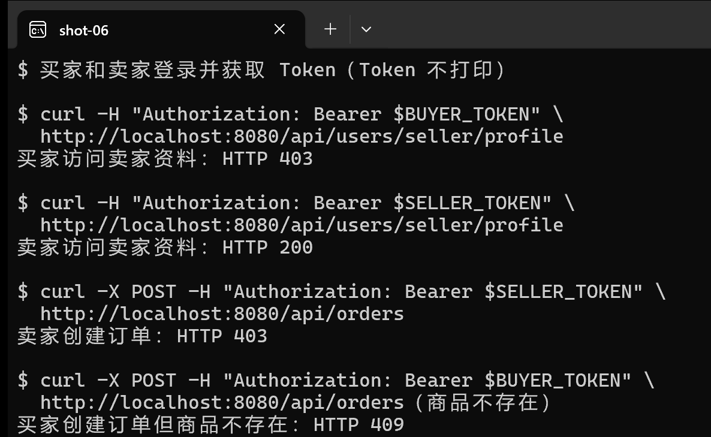
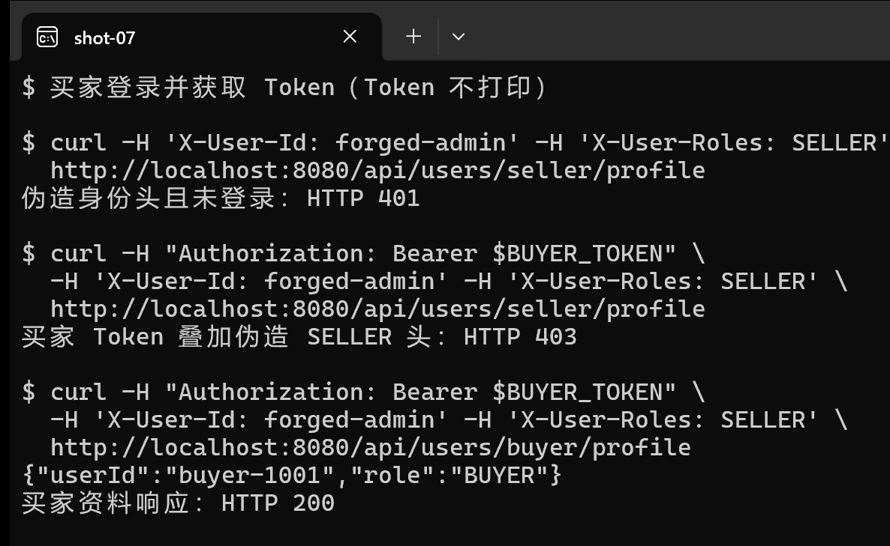

# 第九周：API 网关与认证授权

## API Gateway

### 实现思路

新增独立 `services/gateway-service/` Spring Cloud Gateway WebFlux 工程，监听容器内 `8080`，通过 Nacos 服务发现按服务名转发三类请求：`/api/users/**` 到 `user-service`、`/api/items/**` 到 `item-service`、`/api/orders/**` 到 `order-service`。网关提供 `/actuator/health` 健康检查。Compose 将网关端口映射为宿主机 `GATEWAY_PORT`（默认 8080）。

网关路由验证已完成。用户服务另提供登录与 JWT 角色校验；商品、订单服务的完整资源级授权仍属于后续完善范围。业务服务端口保留给本机调试，统一访问入口为网关。

### 运行命令

需先按第七周说明配置本地 `.env` 并启动 Nacos 与业务服务：

```bash
docker compose up -d --build gateway-service
curl -i http://localhost:8080/actuator/health
curl -i http://localhost:8080/api/items/item-1001
curl -i http://localhost:8080/api/users/buyer-1001/exists
```

健康检查应返回 HTTP 200 且状态 `UP`。若需手动完整启动依赖：

```bash
docker compose up -d nacos user-db item-db order-db user-service item-service order-service gateway-service
```

### 验证结果

已使用当前源码重新构建并启动网关，宿主机入口为 `http://localhost:8080`。验证结果：

- `GET /actuator/health`：HTTP 200，状态 `UP`。
- `GET /api/items/item-1001`：HTTP 200，返回商品 `Java 编程教材`。
- `GET /api/users/buyer-1001/exists`：HTTP 200。
- `POST /api/orders`，请求体使用不存在的商品 ID：HTTP 409，业务返回“商品不存在”，证明请求已转发到订单服务且未创建订单。

验证结果汇总图：

> 本节验证在启用网关鉴权之前完成。第三节启用鉴权后，`POST /api/orders` 和订单查询需要携带 Token，未登录访问返回 401。

排查时发现原运行容器与当前源码不一致；按当前工程重新构建后，三条业务路由均有下游响应。旧单体源码继续保留在 `monolith/`，本次仅停止占用宿主机 `8080` 的旧运行容器，为网关释放统一入口。业务服务和网关仍使用 Compose 服务名通信。

## 认证服务

### 实现思路

认证实现放在 `services/user-service/`：`POST /api/users/login` 从 `user_credentials` 查询用户的 PBKDF2-HMAC-SHA256 密码哈希并校验，通过后用 HS256 签发含 `sub`、`iss`、有效期和 `roles` 声明的 JWT。受保护资源由 Spring Security Resource Server 验签；`/api/users/buyer/**` 仅允许 BUYER，`/api/users/seller/**` 仅允许 SELLER。登录接口、健康检查和现有用户存在性查询可匿名访问。

JWT 密钥只从本地 `.env` 的 `JWT_SECRET` 注入，要求至少 32 UTF-8 字节；不要提交 `.env` 或真实密钥。演示账号的数据库只保存带独立盐值的 PBKDF2 哈希，不保存明文密码。

### 测试账号与角色

| 用户 ID | 密码 | 角色 |
|---|---|---|
| buyer-1001 | BuyerDemo!2026 | BUYER |
| seller-1001 | SellerDemo!2026 | SELLER |
| seller-1002 | SellerDemo!2026 | SELLER |

这些是课程演示凭据，不可用于生产环境。

### 运行与验证命令

在仓库根目录启动依赖和用户服务、网关：

```bash
docker compose up -d --build user-service gateway-service
```

以下命令会验证买家和卖家登录、JWT 访问、跨角色拒绝、无 Token 拒绝和错误密码拒绝；JWT 只保存在 shell 变量中，不打印：

```bash
BUYER_TOKEN=$(curl -fsS -H 'Content-Type: application/json' \
  -d '{"userId":"buyer-1001","password":"BuyerDemo!2026"}' \
  http://localhost:8080/api/users/login | jq -r .accessToken)
SELLER_TOKEN=$(curl -fsS -H 'Content-Type: application/json' \
  -d '{"userId":"seller-1001","password":"SellerDemo!2026"}' \
  http://localhost:8080/api/users/login | jq -r .accessToken)
curl -i -H "Authorization: Bearer $BUYER_TOKEN" http://localhost:8080/api/users/buyer/profile
curl -i -H "Authorization: Bearer $BUYER_TOKEN" http://localhost:8080/api/users/seller/profile
curl -i -H "Authorization: Bearer $SELLER_TOKEN" http://localhost:8080/api/users/seller/profile
curl -i http://localhost:8080/api/users/buyer/profile
curl -i -H 'Content-Type: application/json' \
  -d '{"userId":"buyer-1001","password":"wrong"}' \
  http://localhost:8080/api/users/login
```

预期状态依次为 `200、403、200、401、401`。登录成功响应含 `accessToken`、`role` 和 `expiresIn`。自动化密码哈希测试：

```bash
./monolith/mvnw -B -f services/user-service/pom.xml test
```

### 截图命令与命名

在 Ubuntu 终端执行上一节的登录与权限验证命令。登录成功信息只显示角色，不打印完整 JWT；权限验证输出应能看到 `200、403、200、401、401`。需要截取状态码时可使用：

```bash
curl -sS -o /dev/null -w '买家资源 HTTP %{http_code}\n' \
  -H "Authorization: Bearer $BUYER_TOKEN" http://localhost:8080/api/users/buyer/profile
curl -sS -o /dev/null -w '越权访问 HTTP %{http_code}\n' \
  -H "Authorization: Bearer $BUYER_TOKEN" http://localhost:8080/api/users/seller/profile
curl -sS -o /dev/null -w '未登录访问 HTTP %{http_code}\n' \
  http://localhost:8080/api/users/buyer/profile
```

截图保存到本目录，建议命名为 `03-auth-login-jwt.png`（两类账号登录及角色）和 `04-auth-role-authorization.png`（授权成功、越权 403、未登录 401）。
### 验证结果

已在 Compose 环境通过网关实际验证：买家和卖家登录成功；买家访问买家资源返回 200、越权访问卖家资源返回 403；卖家访问卖家资源返回 200；未携带 Token 和错误密码均返回 401。用户服务使用外部 JWT 密钥启动，密码哈希表已创建。
## 网关鉴权

### 实现思路

网关新增 `SecurityConfig`，使用与 `user-service` 相同的 `JWT_SECRET` 配置 `NimbusReactiveJwtDecoder`，以 HS256 验签并校验有效期。`roles` 声明映射为 `ROLE_BUYER`、`ROLE_SELLER`，鉴权失败统一返回包含 `status`、`error`、`message`、`path` 的 JSON：未登录或 Token 无效为 401，角色不足为 403。

鉴权规则如下：

| 接口 | 访问规则 |
|---|---|
| `POST /api/users/login`、`GET /api/users/{userId}/exists` | 匿名 |
| `GET /api/items/**`、`GET /actuator/health` | 匿名 |
| `POST /api/items/{itemId}/reserve` | BUYER |
| `/api/users/buyer/**` | BUYER |
| `/api/users/seller/**` | SELLER |
| `POST /api/orders` | BUYER |
| 其他网关路由 | 已登录用户 |

`IdentityHeaderFilter` 在转发前删除客户端自带的 `X-User-Id`、`X-User-Roles`，只在 JWT 验签通过后按 `sub` 和 `roles` 重新写入，因此伪造身份头不会改变鉴权结果。下游服务不将这些头作为授权依据，`user-service` 仍独立验签。Compose 中业务服务端口只绑定 `127.0.0.1` 供本机排查；正式部署应取消这些端口映射，仅暴露网关，业务服务留在内部网络。完整认证流程、角色权限和路由表见 [`docs/security.md`](../../security.md)。

### 运行命令

重新构建并启动网关，确保用户、商品、订单服务和 Nacos 已运行：

```bash
docker compose up -d --build gateway-service
curl -i http://localhost:8080/actuator/health
```

在 Ubuntu 终端执行以下命令验证未登录、登录后访问和角色校验。Token 只保存在 shell 变量中，不打印：

```bash
BUYER_TOKEN=$(curl -fsS -H 'Content-Type: application/json' \
  -d '{"userId":"buyer-1001","password":"BuyerDemo!2026"}' \
  http://localhost:8080/api/users/login | jq -r .accessToken)
SELLER_TOKEN=$(curl -fsS -H 'Content-Type: application/json' \
  -d '{"userId":"seller-1001","password":"SellerDemo!2026"}' \
  http://localhost:8080/api/users/login | jq -r .accessToken)

curl -sS -o /dev/null -w '未登录创建订单：HTTP %{http_code}\n' \
  -H 'Content-Type: application/json' \
  -d '{"itemId":"item-1001","buyerId":"buyer-1001"}' \
  http://localhost:8080/api/orders
curl -sS -o /dev/null -w '买家登录后访问买家资料：HTTP %{http_code}\n' \
  -H "Authorization: Bearer $BUYER_TOKEN" \
  http://localhost:8080/api/users/buyer/profile
curl -sS -o /dev/null -w '买家访问卖家资料：HTTP %{http_code}\n' \
  -H "Authorization: Bearer $BUYER_TOKEN" \
  http://localhost:8080/api/users/seller/profile
curl -sS -o /dev/null -w '卖家访问卖家资料：HTTP %{http_code}\n' \
  -H "Authorization: Bearer $SELLER_TOKEN" \
  http://localhost:8080/api/users/seller/profile
```

伪造身份头验证：

```bash
curl -sS -o /dev/null -w '伪造身份头且未登录：HTTP %{http_code}\n' \
  -H 'X-User-Id: forged-admin' -H 'X-User-Roles: SELLER' \
  http://localhost:8080/api/users/seller/profile
curl -sS -o /dev/null -w '买家 Token 叠加伪造 SELLER 头：HTTP %{http_code}\n' \
  -H "Authorization: Bearer $BUYER_TOKEN" \
  -H 'X-User-Id: forged-admin' -H 'X-User-Roles: SELLER' \
  http://localhost:8080/api/users/seller/profile
curl -sS -H "Authorization: Bearer $BUYER_TOKEN" \
  -H 'X-User-Id: forged-admin' -H 'X-User-Roles: SELLER' \
  http://localhost:8080/api/users/buyer/profile
```

前两条应分别返回 401 和 403；最后一条返回的 `userId` 应为 JWT 中的 `buyer-1001`，不是伪造的 `forged-admin`。

### 验证结果

已在 Compose 环境重新构建网关并完成真实请求验证，结果如下：

| 验证场景 | 实际结果 |
|---|---|
| 网关健康检查 | HTTP 200，`status=UP` |
| 未登录创建订单 | HTTP 401，返回 JSON 错误 |
| 买家 Token 访问买家资料 | HTTP 200，返回 `userId=buyer-1001` |
| 无效 Token | HTTP 401，返回 JSON 错误 |
| 买家访问卖家资料 | HTTP 403 |
| 卖家访问卖家资料 | HTTP 200 |
| 卖家创建订单 | HTTP 403 |
| 买家创建订单但商品不存在 | HTTP 409，请求已转发到订单服务 |
| 匿名查询商品 / 匿名锁定商品 | HTTP 200 / HTTP 401 |
| 卖家锁定商品 / 买家锁定不存在商品 | HTTP 403 / HTTP 404 |
| 伪造身份头且未登录 | HTTP 401 |
| 买家 Token 叠加伪造 SELLER 头访问卖家资料 | HTTP 403 |
| 买家 Token 叠加伪造身份头访问买家资料 | HTTP 200，响应仍为 `userId=buyer-1001` |

未登录、携带 Token 和无效 Token 验证：



角色权限验证：



伪造身份头验证：



## 作业系统说明

API Gateway 已新增独立 Spring Cloud Gateway 工程，并在 Compose 中接入 Nacos 服务发现。网关监听 8080，配置用户、商品、订单三条按服务名转发的路由和 Actuator 健康检查。验证方式为启动依赖及网关后请求 `/actuator/health` 和三类业务路径。

网关已统一校验 JWT 并实现 BUYER/SELLER 角色权限，未登录或无效 Token 返回 401，越权访问返回 403；转发前清除并覆盖客户端伪造的身份头。通过 Compose 启动网关及依赖服务后，使用买家、卖家 Token 和伪造请求头访问受保护接口即可验证。

## 测试账号与角色

| 账号 | 角色 | 状态 |
|---|---|---|
| buyer-1001 | 买家 / BUYER | 密码与登录方式见“认证服务” |
| seller-1001 | 卖家 / SELLER | 密码与登录方式见“认证服务” |
| seller-1002 | 卖家 / SELLER | 密码与登录方式见“认证服务” |

演示账号凭据和 JWT 验证结果见下方“认证服务”小节。
