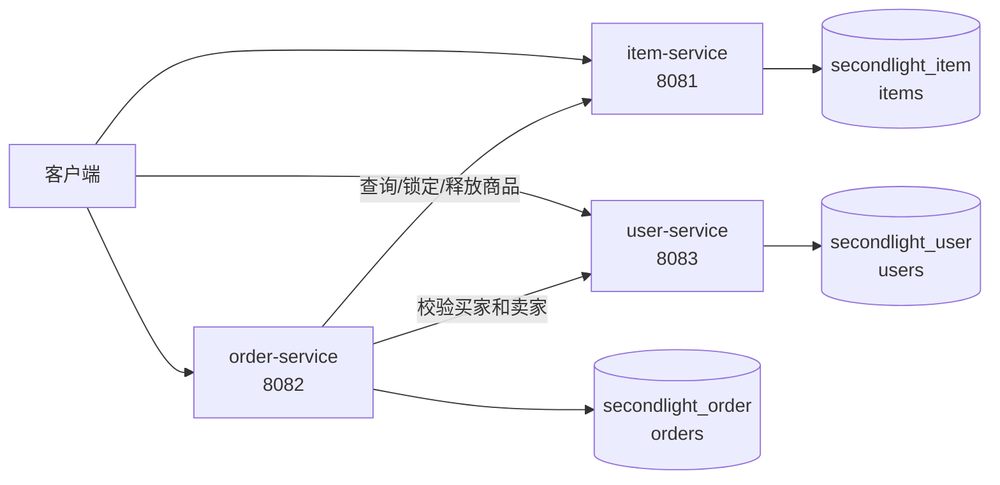

# 拾光集微服务拆分设计

## 1. 拆分目标

保留现有 `monolith/` 作为单体版本，在不覆盖单体工程的前提下，将商品、订单和用户相关职责拆成独立 Spring Boot 服务。每个服务只访问自己的数据库，服务之间通过 HTTP API 传递业务数据。

本次拆分使用统一基础包名 `com.zjgsu.hyh`，各服务的业务代码放在该包的子包中。

## 2. 单体到服务的映射

| 单体代码 | 微服务 | 拆分原因 |
|---|---|---|
| `model.Item`、`ItemRepository`、商品查询接口 | `item-service` | 商品库存和商品状态是一组完整的业务规则 |
| `model.Order`、`OrderRepository`、下单/取消接口 | `order-service` | 订单状态和下单流程需要独立演进 |
| `Item.sellerId`、`Order.buyerId`、`Order.sellerId` | `user-service` | 用户身份和基础资料不应由商品或订单服务维护 |
| `ItemOrderService` 中的跨对象流程 | `order-service` 编排 | 订单服务通过 HTTP 获取商品和用户信息，不直接访问其他服务的 Repository |

## 3. 服务边界

### 3.1 item-service

- **职责：** 商品发布、商品详情查询、商品状态和库存管理。
- **端口：** `8081`
- **数据库：** `secondlight_item`
- **数据表：** `items`
- **接口示例：**
  - `GET /api/items/{itemId}`：查询商品详情和当前状态。
  - `POST /api/items/{itemId}/reserve`：为订单锁定商品。
  - `POST /api/items/{itemId}/release`：取消订单后恢复商品。
- **不负责：** 用户登录、订单状态和订单记录。

### 3.2 order-service

- **职责：** 创建订单、查询订单、取消待支付订单和维护订单状态。
- **端口：** `8082`
- **数据库：** `secondlight_order`
- **数据表：** `orders`
- **接口示例：**
  - `POST /api/orders`：创建订单。
  - `GET /api/orders/{orderId}`：查询订单详情。
  - `POST /api/orders/{orderId}/cancel`：取消待支付订单。
- **调用关系：** 创建订单前调用 `item-service` 检查并锁定商品，并调用 `user-service` 校验买家和卖家 ID。订单中只保存 `itemId`、`buyerId` 和 `sellerId`，不保存跨库外键。
- **不负责：** 直接修改商品表或用户表。

### 3.3 user-service

- **职责：** 用户基础资料、用户 ID 校验和卖家/买家身份信息查询。
- **端口：** `8083`
- **数据库：** `secondlight_user`
- **数据表：** `users`
- **接口示例：**
  - `GET /api/users/{userId}`：查询用户基础信息。
  - `GET /api/users/{userId}/exists`：检查用户是否存在。
- **不负责：** 商品库存和订单状态。

## 4. 数据归属和一致性

每个服务只读写自己的数据库：

| 数据库 | 所属服务 | 数据表 |
|---|---|---|
| `secondlight_item` | item-service | `items` |
| `secondlight_order` | order-service | `orders` |
| `secondlight_user` | user-service | `users` |

订单表中的 `item_id`、`buyer_id` 和 `seller_id` 都是对方服务的业务 ID，只保存字符串，不建立跨数据库外键。订单创建时先通过 HTTP 校验用户和商品，避免订单服务直接依赖其他服务的实体或 Repository。

跨服务调用失败时，订单创建不返回成功；商品锁定失败时不生成订单。取消订单时，订单服务先校验订单状态，再请求商品服务释放库存。

## 5. 服务调用关系

1. 客户端向 `order-service:8082` 发起创建订单请求。
2. `order-service` 调用 `user-service:8083` 校验买家和卖家。
3. `order-service` 调用 `item-service:8081` 查询并锁定商品。
4. 所有校验通过后，`order-service` 在自己的数据库保存订单。
5. 取消订单时，`order-service` 将订单改为取消状态，并调用 `item-service` 恢复商品状态。

当前阶段使用同步 HTTP 调用，后续如果需要订单通知，再考虑消息队列，不在本次拆分中提前引入。

## 6. 架构图



## 7. 拆分后的目录约定

```text
services/
├── item-service/
│   ├── pom.xml
│   └── src/
├── order-service/
│   ├── pom.xml
│   └── src/
└── user-service/
    ├── pom.xml
    └── src/
```

三个服务都保留独立的 `pom.xml`、`src/main`、`src/test` 和健康接口。服务之间只依赖公开 HTTP 契约，不通过 Maven 依赖对方的 Repository 或实体类。
