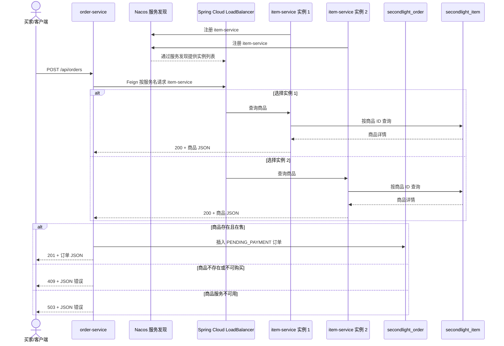

# 服务间同步调用与负载均衡

## 业务流程

本项目选择“创建二手商品订单前校验商品”流程。买家向 `order-service` 提交商品 ID 和买家 ID；订单服务通过 OpenFeign 请求 `item-service` 查询商品，再根据返回的商品状态、价格和卖家 ID 创建本地订单。订单服务只负责订单数据，不直接访问商品数据库。



## 调用方、被调用方与接口

| 角色 | 服务 | 接口/职责 |
|---|---|---|
| 调用方 | `order-service` | `POST /api/orders` 接收下单请求；订单创建前调用商品服务 |
| 被调用方 | `item-service` | `GET /api/items/{itemId}` 返回商品 ID、标题、价格、卖家 ID 和在售状态 |
| 服务发现 | Nacos `DEFAULT_GROUP` | 提供 `item-service` 实例列表 |
| 负载均衡 | Spring Cloud LoadBalancer | Feign 使用服务名 `item-service`，在注册实例间选择目标，不绑定某个容器地址 |

`order-service` 使用 `@FeignClient(name = "item-service")` 声明 HTTP 契约，并通过 OpenFeign 的连接/读取超时配置限制等待时间。未配置自动重试；商品查询为只读操作，网络错误与远程服务不可用（包括服务无实例）统一转换为 `503 Service Unavailable`，避免把依赖故障伪装成下单成功。远程返回 `404` 转为 `409 Conflict` 商品业务错误；商品不可购买也返回 `409`。**商品不存在/不可购买的 `409` 与商品服务不可用的 `503` 是不同场景。** 校验未成功时不会写入订单。

工作区现有进度 PPT 第 5 页的服务故障恢复示例展示了依赖服务下线时订单请求返回 `503`、服务恢复后返回 `201`。本项目沿用这一故障语义；新增的作业端到端脚本会停掉全部商品服务实例，等待 Nacos 移除实例后验证 `503` 且订单数不变，再恢复实例并验证 `201` 和订单 JSON。已存在的 `409` 商品校验分支作为独立业务错误保留，不与依赖故障场景混用。

## 数据与一致性边界

- 商品只由 `item-service` 及其 `secondlight_item` 数据库维护；订单只由 `order-service` 及其 `secondlight_order` 数据库维护。
- 订单中保存商品 ID、买家 ID、卖家 ID 和创建时价格，不建立跨库外键。
- 此流程是同步的“查询商品后创建订单”，不是跨服务事务。商品状态可能在校验与订单保存之间变化；当前实现不会锁定/预留商品，也没有分布式事务或补偿。
- 多实例验证用两个独立的 `item-service` 容器接收请求；每个实例仍连接同一个商品数据库。这里验证的是服务实例负载均衡，不代表数据库读写扩展。

## 验证方式

在仓库根目录执行服务单元测试：

```bash
bash monolith/mvnw -B -f services/order-service/pom.xml test
```

先在本地 `.env` 中按 `README`/第七周说明配置 Nacos 凭据并启动 Docker，再执行端到端验证：

```bash
bash scripts/e2e-test.sh
```

脚本使用根目录 `compose.yaml`，将商品服务扩容为两个实例，并临时使用随机宿主机端口避免端口冲突。它检查两实例健康、真实下单 JSON、错误商品不落订单，以及同一批 Feign 请求确实到达两个实例；随后停止两个实例，验证依赖不可用时返回 `503` 且不落订单，再启动实例验证恢复后返回 `201`。脚本退出时移除本次 Compose 容器和网络，不删除数据库卷；如果当前项目已有运行中的 Compose 容器，脚本会先退出，避免打断已有环境。

本地完成验证后，可将运行记录截图保存为 `docs/homework/week-08/screenshots/` 下的 `01-e2e-load-balancing.png`。不要将 `.env` 中的凭据放入截图。
